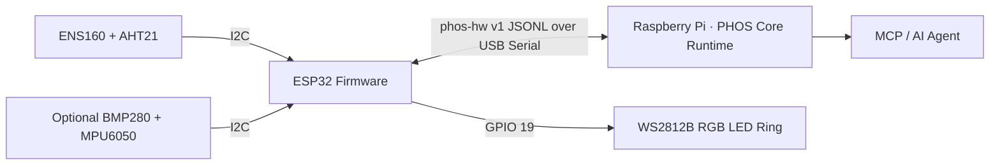

# PHOS ESP32 Firmware

Official ESP32 companion firmware implementing the `phos-hw v1` serial JSONL protocol for environmental telemetry and semantic RGB LED control.

[](https://github.com/phosairobot/phos-esp32)
[](LICENSE)
[](https://phosairobot.github.io/phos/)
[](#quick-start)
[](https://github.com/phosairobot/phos)

> [!TIP]
> **Building a PHOS robot?** Give both [phos-esp32](https://github.com/phosairobot/phos-esp32) and the core [PHOS repository](https://github.com/phosairobot/phos) a ⭐ **Star** to follow hardware updates and new sensor drivers!

## Architecture

The ESP32 samples connected sensors, publishes telemetry, and renders LED animations requested by the Raspberry Pi. PHOS Core connects that hardware context to MCP and external AI agents.



The PlatformIO target is **ESP32 Dev Module** (`board = esp32dev`, platform `espressif32`) with the **Arduino** framework. Dependencies are Adafruit BMP280, AHTX0 (`^2.0.6`), MPU6050, Unified Sensor, BusIO, NeoPixel (`^1.12.5`), ScioSense_ENS16x (`2.0.5`), and ArduinoJson (`^7.4.2`); see [platformio.ini](platformio.ini).

## Hardware Wiring & Pinout

These mappings come from [HardwareConfig.h](src/config/HardwareConfig.h), [SensorManager.cpp](src/sensors/SensorManager.cpp), and [LedOutput.h](src/led/LedOutput.h).

| Component | Interface | ESP32 Pin | Notes / Power |
| --- | --- | --- | --- |
| ENS160 + AHT21 | I2C SDA | GPIO 21 | Shared data bus; ENS160 at `0x53`, fallback `0x52`; AHT21 at `0x38` |
| ENS160 + AHT21 | I2C SCL | GPIO 22 | Shared clock bus; AHT21 supplies temperature/humidity compensation to ENS160 |
| BMP280 (optional) | I2C SDA / SCL | GPIO 21 / GPIO 22 | Temperature and pressure; `0x76`, fallback `0x77` |
| MPU6050 (optional) | I2C SDA / SCL | GPIO 21 / GPIO 22 | Acceleration, angular velocity, and motion events; `0x68`, fallback `0x69` |
| WS2812B ring | Data input (DIN) | GPIO 19 | **12 RGB LEDs**, GRB order, 800 kHz signaling; power from a suitable 5 V supply |
| All modules | Ground | GND | Common ground between ESP32, sensors, and LED supply |
| Raspberry Pi / host | USB serial | Board USB connector | `115200` baud, 8N1, via the board's USB-to-UART interface |

Sensor supply voltage depends on the breakout board and is not specified in firmware: follow its ratings and keep the ESP32 I2C bus at 3.3 V logic. For a 5 V ring, use appropriate data-level shifting. Size its supply for the ring's current demand.

The ring calibration places physical LED **6 at the top** and LED **0 at the bottom**, with increasing physical indices clockwise. Firmware rendering starts with requested brightness `0.15` and caps output at `0.25` through the current build flags. This cap is a temporary hardware-stability mitigation, not a resolution of power or signal-integrity issues.

## Quick Start

Install [PlatformIO Core](https://docs.platformio.org/en/latest/core/installation/index.html), connect the ESP32 with a USB data cable, then run:

```bash
git clone https://github.com/phosairobot/phos-esp32.git
cd phos-esp32
pio run -e esp32dev
pio run -e esp32dev -t upload
pio device monitor -e esp32dev -b 115200 --echo --eol LF
```

If multiple serial devices are connected, use `pio device list`, then add `--upload-port PORT` to the upload command and `--port PORT` to the monitor command. Close the monitor before uploading or connecting PHOS Core.

After reset, expect a `hello` frame and periodic `heartbeat` frames. Paste each of these complete JSON lines into the monitor and press Enter after each line:

```jsonl
{"protocol":"phos-hw","version":1,"type":"request_capabilities","payload":{}}
{"protocol":"phos-hw","version":1,"type":"ping","payload":{}}
{"protocol":"phos-hw","version":1,"type":"set_led_animation","payload":{"animation":"solid","color":"#00FF00","brightness":0.15}}
{"protocol":"phos-hw","version":1,"type":"clear_led","payload":{}}
```

Expect `capabilities` followed by `ack`, a `heartbeat` reply to `ping`, and `ack` replies for the LED commands. Sensor frames depend on the connected hardware. The monitor's local echo displays your input alongside firmware output.

Use the **`esp32dev`** environment for PHOS. The separate `esp32_led_test` environment flashes a standalone ring diagnostic with human-readable output instead of the PHOS protocol.

## phos-hw v1 Serial Protocol

The transport runs at **115200 baud** with one JSON object per line, terminated by LF (`\n`). Input ignores CR (`\r`) and empty lines, accepts up to **8192 bytes** before LF (excluding ignored CR bytes), and discards oversized input through the next LF. Each incoming envelope requires `protocol: "phos-hw"`, `version: 1`, a supported `type`, and an object `payload`. Outgoing frames also include `timestamp_ms`, measured from ESP32 startup:

```json
{"protocol":"phos-hw","version":1,"type":"sensor_update","timestamp_ms":15000,"payload":{"sensor":"humidity","value":45.2,"unit":"%rh"}}
```

### Incoming commands

| Type | Payload / behavior | Reply |
| --- | --- | --- |
| `request_capabilities` | `{}`; discover initialized sensors and LED count | `capabilities`, then `ack` |
| `ping` | `{}` | `heartbeat` |
| `set_led_animation` | `animation`; optional `color`, `brightness`, `period_ms`, `duration_ms`, `min_intensity`, `max_intensity`, `direction`, `mode`, `origin` | `ack` or `error` |
| `set_led_brightness` | Numeric `brightness`, clamped to `0.0`–`1.0`; rendering applies the build-time ceiling | `ack` or `error` |
| `clear_led` | `{}`; turn all pixels off | `ack` or `error` |
| `stop_led_animation` | `{}`; stop animation and turn all pixels off | `ack` or `error` |
| `configure_sensor_reporting` | Object payload accepted and acknowledged; currently does not change reporting settings | `ack` |

Supported animations are `off`, `solid`, `blink`, `pulse`, `breathe`, `chase`, `spin`, and `wipe`. Colors use `#RRGGBB`. Animation defaults are white, brightness `1.0`, period `1000` ms, duration `0` (no automatic expiry), and intensity range `0.0`–`1.0`; period must be nonzero.

`chase` and `wipe` support `circular` mode with `clockwise` or `counterclockwise` direction. Circular `wipe` additionally accepts an origin. Both support `symmetric` mode when an explicit `outward` or `inward` direction and an origin (`top`, `bottom`, `left`, `right`) are supplied. `spin` accepts circular mode and clockwise/counterclockwise direction only. The other animations reject direction, mode, and origin fields.

`hello` is an **outgoing boot announcement**, not an incoming command. Robot semantic states are translated into these animation commands by the host; this firmware has no separate semantic-state command.

### Outgoing telemetry and events

| Type | Payload / timing |
| --- | --- |
| `hello` | `controller: "esp32"`; emitted at boot |
| `capabilities` | Detected capabilities: `temperature` and `pressure` for BMP280, `air_quality` for ENS160, `humidity` for AHT21, `motion` for MPU6050; always `led` with `led.count: 12` |
| `heartbeat` | Every 5000 ms, plus immediate replies to `ping` |
| `sensor_update` | `sensor`, `value`, `unit`; identifiers listed below |
| `sensor_status` | `sensor: "ens160"`, `validity`, `compensation_active`; on status changes or every 15000 ms |
| `motion_update` | `state` and `intensity`; on changes |
| `orientation_update` | XYZ objects `acceleration_m_s2` and `angular_velocity_dps`; changes published at most every 200 ms, refreshed every 5000 ms |
| `ack` / `error` | `command`, `ok`; errors also carry an `error` code |

Environmental sensors are sampled every **1000 ms**. Values publish initially, on significant change, and on a **15000 ms** refresh interval when samples are available:

| Sensor identifier | Source | Unit | Change threshold |
| --- | --- | --- | --- |
| `temperature` | BMP280 | `c` | 0.2 °C |
| `pressure` | BMP280 | `hpa` | 0.5 hPa |
| `aht21_temperature` | AHT21 | `c` | 0.2 °C |
| `humidity` | AHT21 | `%rh` | 0.5 percentage points |
| `eco2` | ENS160 | `ppm` | 50 ppm; equivalent CO₂ estimate |
| `tvoc` | ENS160 | `ppb` | 10 ppb |
| `aqi` | ENS160 | `index` | Any change; values 1–5 |

ENS160 readings can be emitted during warm-up. Interpret them alongside `sensor_status.validity`: `0` normal, `1` warm-up, `2` initial start-up, `3` no valid output. Warm-up readings must not be treated as ready environmental measurements.

The MPU6050 is sampled locally every **20 ms**. Motion states are `stationary`, `moving`, `tilt_left`, `tilt_right`, `tilt_forward`, `tilt_backward`, `shake`, and `impact`, with intensity `low`, `medium`, or `high`. Orientation changes use thresholds of 0.3 m/s² acceleration-vector delta or 3 degrees/s angular-velocity-vector delta.

Current `esp32dev` build flags enable `controller_status` diagnostics in boot and periodic heartbeat payloads. An immediate `ping` reply has an empty payload. Protocol error codes include `malformed_frame`, `invalid_envelope`, `invalid_payload`, `invalid_parameter`, `led_unavailable`, `unknown_message_type`, and `frame_too_large`.

Protocol implementation: [main.cpp](src/main.cpp). Sampling intervals and thresholds: [ReportingConfig.h](src/config/ReportingConfig.h).

## PHOS Ecosystem

| Repository | Role |
| --- | --- |
| **[phos](https://github.com/phosairobot/phos)** | Core Raspberry Pi robot runtime, Vision, Voice, Web Admin, REST API & MCP Server. |
| **[phos-esp32](https://github.com/phosairobot/phos-esp32)** | ESP32 hardware controller firmware (`phos-hw v1`). |
| **[phos-mcp-bridge](https://github.com/phosairobot/phos-mcp-bridge)** | Local `stdio` ↔ remote `Streamable HTTP` MCP bridge for desktop AI clients. |

## Contributing & License

Start with the [PHOS documentation](https://phosairobot.github.io/phos/). Issues and pull requests for new sensor drivers, hardware validation, protocol improvements, and documentation are welcome in [phos-esp32](https://github.com/phosairobot/phos-esp32/issues).

Licensed under the **Apache License, Version 2.0 (Apache-2.0)**. See [LICENSE](LICENSE) for the full text.
